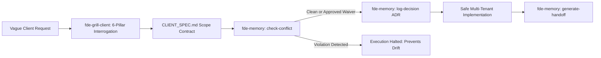

# FDE Skills: Engineering Intelligence Suite for Forward Deployed Engineers

A specialized repository of modular engineering skills designed for Forward Deployed Engineers (FDEs), FieldOps leads, and AI coding agents (Claude Code, Antigravity, and tool-calling LLMs).

Inspired by the philosophy of Matt Pocock's agent skills, this repository solves the chaotic reality of client engineering: multi-tenant divergence, silent architectural drift, and vague client requests.

---

## Skills Included in this Repository

| Skill | Path | Description | Key Capabilities |
| :--- | :--- | :--- | :--- |
| **`fde-memory`** | [`fde-skills/fde-memory/`](fde-skills/fde-memory/) | Context manager & Architectural Decision Record (ADR) engine | Multi-client isolation, selective key retrieval (token economy), automated conflict detection (`check-conflict`), and dual-format handoff packages. |
| **`fde-grill-client`** | [`fde-skills/fde-grill-client/`](fde-skills/fde-grill-client/) | Socratic requirements stress-testing & scope contract generator | 6-pillar FDE discovery (Network, Auth, Data Residency, Failure Modes, InfoSec, Rollback), client domain glossary modeling, and `CLIENT_SPEC.md` generation. |

---

## Architecture: The FDE Operational Loop



---

## Quick Start: Adding to Claude Code / Agent Systems

### 1. Installation
Clone the repository into your workspace:

```bash
git clone https://github.com/<your-username>/fde-skills.git
cd fde-skills/fde-skills
pip install -r requirements.txt
```

### 2. Usage Examples in Claude

Once added to your agent's environment, invoke the skills naturally:

- **Requirements Interrogation & Scope Contracts:**
  > *"Grill this new feature request from Acme Corp for an external webhook integration."*  
  *(Triggers `fde-grill-client` to run the 6-pillar discovery interview and generate `CLIENT_SPEC.md`)*

- **Checking Constraints & Logging Decisions:**
  > *"Check the database constraints for Acme Corp and log Aurora PostgreSQL as the chosen database."*  
  *(Triggers `fde-memory` to run `check-conflict` and record the ADR with mandatory justification)*

- **Generating Project Handoffs:**
  > *"Generate an FDE handoff package for Acme Corp."*  
  *(Triggers `fde-memory` to produce a human markdown summary and machine YAML state)*

---

## Repository Structure

```
.
|-- README.md                      # Repository root overview and navigation
|-- .gitignore                     # Global protections (excludes .fde-memory/ client data)
`-- fde-skills/                    # Core skill package directory
    |-- README.md                  # Detailed CLI execution guide, API runbook, & schemas
    |-- LICENSE                    # MIT Open Source License
    |-- requirements.txt           # Python dependencies (pyyaml>=6.0)
    |-- fde-memory/                # Skill: Persistent memory & drift guardrails
    |   |-- SKILL.md               # Agent system prompt
    |   |-- scripts/               # Core execution CLI (fde_core.py, datastore.py)
    |   `-- templates/             # Canonical YAML schema
    `-- fde-grill-client/          # Skill: Socratic discovery & scope contracts
        `-- SKILL.md               # Agent system prompt
```

For complete CLI flag documentation, schema specifications, and developer runbooks, see [`fde-skills/README.md`](fde-skills/README.md).
