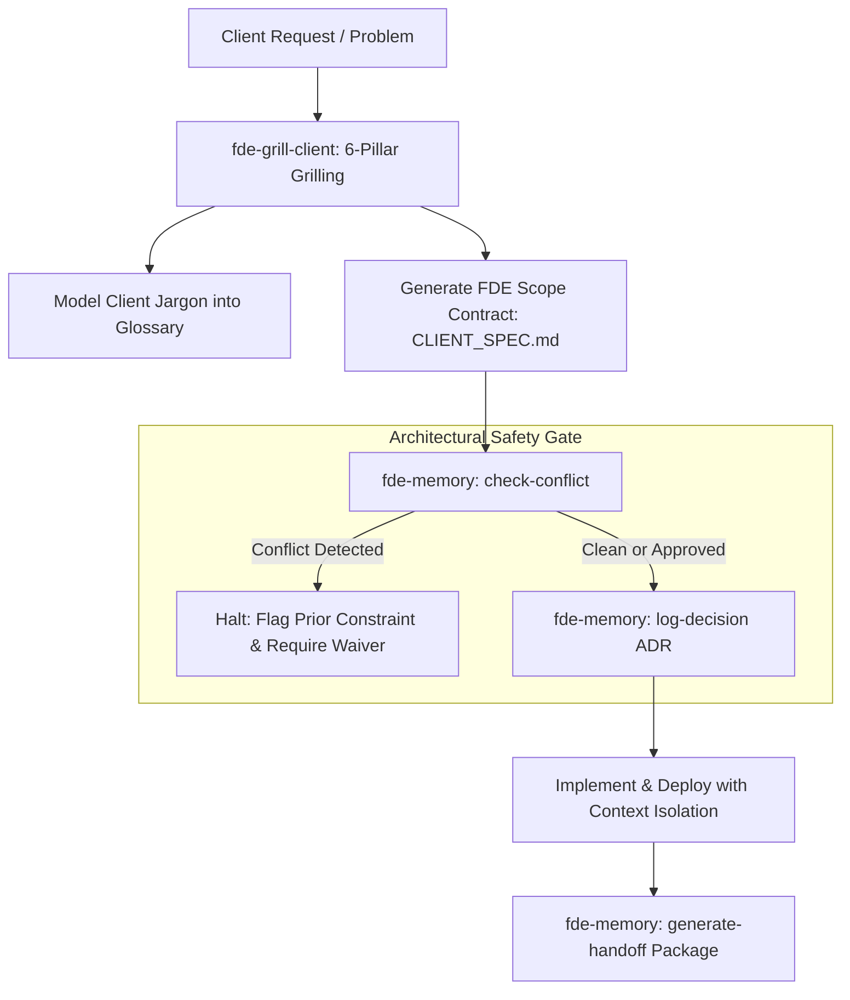

# FDE FieldOps Skill Suite (`fde-skills`)

A modular, production-ready engineering skill suite for Forward Deployed Engineers (FDEs) and AI agents (Claude Code, Antigravity, and tool-calling LLMs).

Inspired by the decoupled, discipline-first architecture of **Matt Pocock's skills repository** (`grill-with-docs`, `to-spec`, domain glossary modeling), this suite is purpose-built for the messy reality of multi-client enterprise deployments.

---

## The Suite at a Glance

| Skill | Directory | Purpose | Inspired By |
| :--- | :--- | :--- | :--- |
| **`fde-memory`** | [`fde-memory/`](fde-memory/) | Deterministic multi-client persistent state, token-budget context retrieval, and architectural conflict guardrails. | Matt Pocock's ADR governance & immutable local context |
| **`fde-grill-client`** | [`fde-grill-client/`](fde-grill-client/) | Socratic requirements stress-testing, 6-pillar FDE discovery, client jargon glossary modeling, and scope contract generation. | Matt Pocock's `grill-with-docs` & `to-spec` |

---

## Complete Lifecycle: How the Skills Work Together

In enterprise field engineering, a customer requirement goes through an interrogation and persistence loop before code is written:



---

## Repository Structure

```
fde-skills/
|-- LICENSE                        # MIT Open Source License
|-- README.md                      # Comprehensive suite documentation
|-- requirements.txt               # Dependencies (pyyaml>=6.0)
|
|-- fde-memory/                    # Persistent Client Memory & Conflict Guardrails
|   |-- SKILL.md                   # Agent system contract for memory management
|   |-- scripts/
|   |   |-- datastore.py           # Abstraction layer for YAML storage & name sanitization
|   |   `-- fde_core.py            # CLI engine for context querying, ADRs, & handoffs
|   `-- templates/
|       `-- client-profile.yaml    # Canonical client profile schema
|
`-- fde-grill-client/              # Socratic Discovery & Scope Contracts
    `-- SKILL.md                   # Agent directives for 6-pillar client interrogation
```

---

## Detailed Skill Breakdown

### 1. `fde-memory` (FieldOps Context & ADR Engine)

Addresses multi-tenant configuration bleed and context degradation.

- **Token Economy**: Uses targeted key retrieval (`get-context --keys "auth,infrastructure"`) instead of feeding entire project archives into the LLM context.
- **Architectural Drift Guardrail**: Before modifying systems, runs `check-conflict`. If a new request violates an existing constraint (e.g. migrating DBs when strict multi-region compliance exists), execution halts until a formal justification and `--force` are provided.
- **Agent Handoffs**: Automatically generates dual-purpose documentation (Executive Markdown + Machine YAML) for cross-team or cross-agent continuity.

#### CLI Quick Reference:
```bash
# Initialize a client profile
python fde-memory/scripts/fde_core.py init-client --client "acme-corp" --infrastructure "AWS eu-central-1" --auth "Okta SAML"

# Check for architectural collisions
python fde-memory/scripts/fde_core.py check-conflict --client "acme-corp" --component "database"

# Log an Architectural Decision Record (fails if conflicting without --force)
python fde-memory/scripts/fde_core.py log-decision --client "acme-corp" --component "database" --decision "Aurora PostgreSQL" --justification "Transactional consistency required"

# Generate handoff
python fde-memory/scripts/fde_core.py generate-handoff --client "acme-corp"
```

---

### 2. `fde-grill-client` (Requirements Grilling & Scope Contract)

Addresses the #1 cause of deployment failure: **vague requirements and premature agreement**.

Inspired by Matt Pocock's philosophy of grilling designs against existing documentation:
- **The 6 FDE Pillars**: Systematically interrogates requests across Network & Host Boundaries, Authentication & Identity, Data Residency, Failure Modes, InfoSec Veto Points, and Maintenance/Rollback.
- **Domain Modeling**: Builds client-specific vocabularies into a local glossary so agents don't hallucinate definitions or misuse client jargon.
- **Scope Contract (`CLIENT_SPEC.md`)**: Synthesizes the interview into explicit in-scope items, non-goals, and security pre-requisites.
- **Direct Bridge to `fde-memory`**: Automatically records the resolved spec choices into `fde-memory` ADRs.

---

## Giving These Skills to Claude

Both skills follow the standard agent skill format and are ready to drop directly into your Claude or Antigravity workflows.

### Method 1: Claude Code / Local Coding Agents
Simply place the `fde-skills/` directory into your project. Claude will index both `fde-memory` and `fde-grill-client`:
- Say `"Grill this new client request for Acme Corp"` to activate `fde-grill-client`.
- Say `"Check the architectural context and deployment rules for Acme Corp"` to activate `fde-memory`.

### Method 2: Claude Projects / Web Workspace
Upload the `fde-skills` directory into your Project Knowledge Base. Claude will adopt the operational contracts defined in each `SKILL.md`.

---

## Best Practices for FDE Teams

1. **Grill Before Committing**: Run `fde-grill-client` before accepting any client timeline or architectural deliverable.
2. **Never Bypass Conflict Checks**: Always run `check-conflict` before generating code or cloud infrastructure templates.
3. **Keep Client Data Local**: The root `.gitignore` excludes `.fde-memory/` to guarantee client secrets, network topologies, and credentials are never checked into git.
